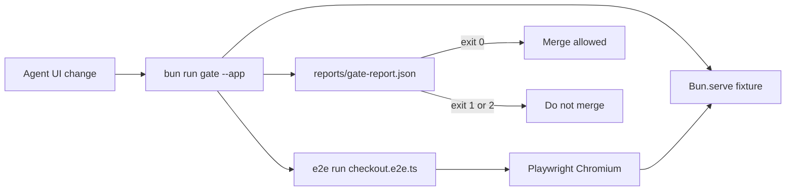

# minilab-e2e-merge-gate

Built by SkilledDragon LLC — architecture-led software engineering — [skilleddragon.com](https://skilleddragon.com)

Palette: `#020617` / `#040F49` / `#006BDF` / `#00BFA6`

## 1. What we built

`minilab-e2e-merge-gate` is a Bun/TypeScript **fail-closed merge gate** that serves a fixture checkout app, runs a Tester Army [`e2e`](https://github.com/tester-army/e2e) Chromium suite (`@e2e-dev/web@0.14.0` at pin `292cd0597c57b4929ad53919f0e4fe40ad87e095`), and writes `reports/gate-report.json`. Exit `0` means pass; exit `1` means a broken user flow; exit `2` means infrastructure failure (missing browser, server down). At agent scale, [según Anthropic](https://www.anthropic.com/engineering/redesigning-source-control), post-merge and pre-deploy automated testing matters because a global merge-queue lock does not scale — this lab is the **pre-merge** version for normal teams. (Scion is internal and not for general use.)

## 2. What we tested

| Slice | Command / surface | Notes |
| --- | --- | --- |
| Lab unit + gate | `bun test` | Pass / fail / infra exit codes + report schema |
| Upstream pin | `git -C upstream rev-parse HEAD` | Must equal `292cd0597c57b4929ad53919f0e4fe40ad87e095` |
| Upstream CI | `.github/workflows/upstream-ci.yml` | Verbatim `spec.yml` steps with A1–A3 only |
| Local upstream leg | `bun run extract:upstream` → `scripts/upstream-test.sh` | check + test@node24 + install@pnpm11 |
| Lint / skills / secrets / audit | `bun run lint`, `check:skills`, gitleaks v8.30.1, `bun audit --audit-level=high` | CI jobs |

See [RESULTS.md](./RESULTS.md) for pass counts, durations, and the CI run URL.

## 3. Setup

```bash
git clone --recurse-submodules https://github.com/SkilledDragonCorp/minilab-e2e-merge-gate.git
cd minilab-e2e-merge-gate
cp .env.example .env
bun install
bun run browsers
bun test
bun run gate --app fixtures/app
```

Node `>=24` (see `.nvmrc`). Bun `1.4.2` (`packageManager` field).

## Tutorial

1. Confirm the good fixture passes:

```bash
export E2E_TELEMETRY_DISABLED=1
bun run gate --app fixtures/app
echo $?
# expected: 0
# expected file: reports/gate-report.json with "outcome": "pass"
```

2. Confirm the broken fixture (confirm button removed) fails closed:

```bash
bun run gate --app fixtures/app-broken
echo $?
# expected: 1
```

3. Confirm missing Chromium is infrastructure failure:

```bash
PLAYWRIGHT_BROWSERS_PATH="$(mktemp -d)" bun run gate --app fixtures/app
echo $?
# expected: 2
```

## Architecture



## 4. Using these skills in Claude Code and Cursor

Skill path: `.claude/skills/e2e-merge-gate/SKILL.md`

- **Claude Code** auto-discovers `.claude/skills/<name>/SKILL.md`. Invoke by asking for the `e2e-merge-gate` skill after a UI change.
- **Cursor** loads the same `.claude/skills` folder. Ask the agent to follow `e2e-merge-gate` and run `bun run gate --app <path>`.

There is no `.cursor/skills` mirror in this repo.

## 5. API keys

| Variable | Required | Where | Needed by |
| --- | --- | --- | --- |
| `E2E_TELEMETRY_DISABLED` | Yes (`1`) | local / CI env | All e2e / gate runs (telemetry opt-out) |
| `DO_NOT_TRACK` | Optional (`1`) | local / CI env | Extra telemetry opt-out |
| `AI_GATEWAY_API_KEY` | Optional | [Vercel AI Gateway](https://vercel.com/docs/ai-gateway) | Authoring `agent.act` via `gateway()` |
| `OPENAI_API_KEY` | Optional | OpenAI dashboard | Authoring with OpenAI models |
| `ANTHROPIC_API_KEY` | Optional | Anthropic console | Authoring with Anthropic models |
| `OPENROUTER_API_KEY` | Optional | OpenRouter | Authoring via OpenRouter |
| `OPENCODE_API_KEY` | Optional | OpenCode Console | Authoring via OpenCode |
| `TYPESAFE_AI_API_KEY` | Optional | TypeSafe AI | Decision / field-text models |
| `LLM_API_KEY` | Optional | Provider-specific | Some upstream decision tests |
| `KERNEL_API_KEY` | Optional | Kernel | Hosted Chromium provider |
| `LIMRUN_API_KEY` | Optional | Limrun | Hosted device provider |
| `EXPO_TOKEN` | Optional | Expo | EAS simulators |
| `E2E_USER_*` / `E2E_SECRET_*` | Optional | local env | Credential / secret overrides |

Locator-only `e2e/checkout.e2e.ts` needs **no model keys**. Mirror names live in `.env.example`.

Telemetry opt-outs used here: `E2E_TELEMETRY_DISABLED`, `DO_NOT_TRACK`.

## 6. License

- This lab: **MIT** (see [LICENSE](./LICENSE))
- Upstream Tester Army e2e: **Apache-2.0** — https://github.com/tester-army/e2e @ `292cd0597c57b4929ad53919f0e4fe40ad87e095`
